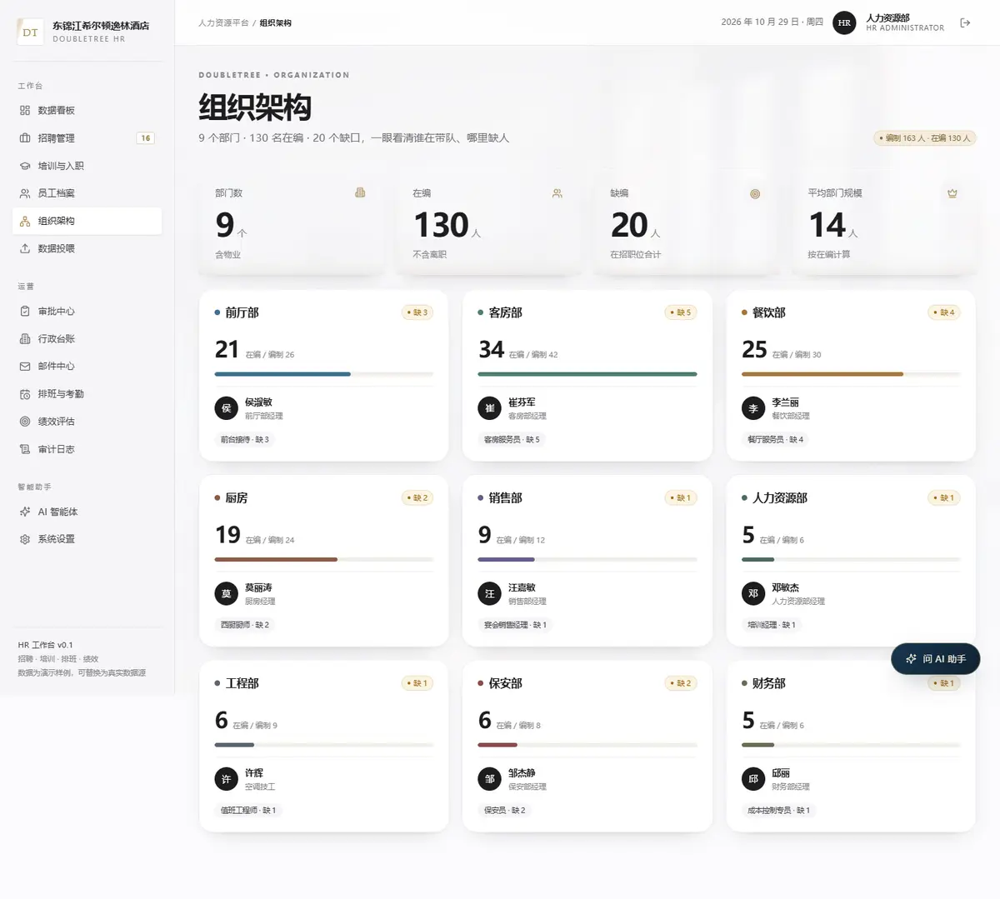

# 东锦江希尔顿逸林酒店 · 人力资源平台

面向酒店 HR 的一体化工作台：招聘、培训、员工档案、排班考勤、绩效、审批、行政台账，加上一个能直接读写业务数据的 AI 智能体。数据落在本地 SQLite，一条命令即可跑起来。


> 仓库内不带任何真实员工数据；演示数据在运行时生成，生产上线请替换并修改登录账号。

## 功能

| 模块 | 能力 |
| --- | --- |
| 数据看板 | 在编/编制缺口、本月入职、培训完成率、出勤率、绩效达标率；部门分布、招聘漏斗、入职趋势、今日待办、本月员工关怀 |
| 招聘管理 | 职位需求、候选人看板（5 阶段）、面试安排、新建职位、候选人阶段流转 |
| 培训与入职 | 课程目录、学习任务进度、逾期跟进、必修清单、分配培训 |
| 员工档案 | 花名册检索/筛选/分页、员工详情（培训、绩效、出勤、排班）、英文名 |
| 组织架构 | 部门卡片：在编/编制、缺口、负责人、在招岗位 |
| 数据投喂 | Excel / CSV 智能识别导入（规则 + DeepSeek 兜底）、覆盖/追加、旧数据存档与回滚、错误明细下载；制度资料投喂知识库 |
| 排班与考勤 | 周排班表（早/中/晚/休）、部门筛选、今日考勤明细与出勤率 |
| 绩效评估 | 周期切换、等级分布、部门平均分、待面谈名单 |
| 审批中心 | 请假/加班/调班/转正/离职/培训申请，提交→审批→通知，带审批意见与留痕 |
| 行政台账 | 健康证到期预警（过期/30 天内）、续期；员工宿舍；临时工/外包台账 |
| 邮件中心 | 面试邀约、培训提醒、入职提醒、审批通知模板；SMTP 真发，未配置进发件箱 |
| 报表中心 | 一键导出 7 个工作表的 Excel（花名册/招聘/候选人/培训/绩效/证照/审批） |
| AI 智能体 | 读全站数据回答问题；生成 JD、方案、图表（PNG）；导出 Word/Excel/PPT/Markdown；可上传表格直接更新数据库 |
| 全局搜索 | ⌘K 搜索员工、职位、页面，直达详情 |
| 审计日志 | 登录、导入、审批、改密、AI 改数据等全部留痕 |

## 界面

| 组织架构 | 全局搜索 |
| --- | --- |
|  |  |


## 技术栈

- **Next.js 15**（App Router）· React 19 · TypeScript
- **Node 24 内置 `node:sqlite`**：零原生依赖，单文件数据库，WAL + `user_version` 迁移
- 手写 CSS 设计系统（暖象牙 / 墨蓝 / 香槟金），无 UI 框架
- 登录鉴权：HMAC 签名 HttpOnly Cookie + scrypt 密码哈希 + 按 IP 限流
- 智能体：DeepSeek / OpenAI 兼容协议 + Function Calling；无 Key 时自动降级本地演示模式
- 文件导出：`docx` / `xlsx` / `pptxgenjs`，图表前端 SVG + PNG

## 快速开始

```bash
npm install
npm run dev          # http://localhost:3000
```

演示账号 `hr` / `doubletree2026`（上线前务必修改）。

生产模式：

```bash
npm run build
npm start
```

## Docker 部署

```bash
cp .env.example .env      # 改 HR_PASS / AUTH_SECRET / DEEPSEEK_API_KEY
docker compose up -d --build
```

数据在 `./data/hr.db`，容器重建不丢。服务器（阿里云 / 腾讯云 Ubuntu 22.04）可用一键脚本：

```bash
bash deploy/deploy.sh
```

Nginx 反代与 HTTPS、每日备份见 [docs/云部署.md](docs/云部署.md)。

## 目录

```
src/app/(app)      业务页面（看板/招聘/培训/员工/组织/审批/台账/报表/智能体…）
src/app/api        REST 接口（导入、导出、审批、AI、搜索…）
src/lib            db / queries / 导入映射 / 智能体工具 / 报表
src/components     手写组件（无 UI 框架）
deploy             服务器脚本与 Nginx 配置
scripts            演示数据、验证、构建与发布脚本
```

## 说明

- 演示数据由 `src/lib/seed.ts` 生成，虚构，仅用于展示
- 智能体修改数据需在「系统设置 → 智能体权限」显式开启，且每次修改写入审计日志
- 不采集身份证、银行卡等敏感字段

## License

MIT
